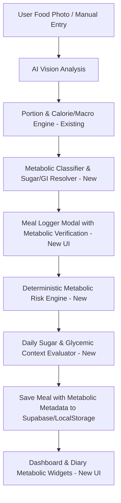

# METABOLIC FEATURE PLAN: PERSONALIZED METABOLIC NUTRITION GUARDRAILS
## Fatty Liver • High Insulin • Added Sugar Control • Low-GI Eating • Meal Timing

---

## 1. Executive Summary & Clinical Philosophy

This document outlines the architectural plan for implementing **Personalized Metabolic Nutrition Guardrails** in the AI Nutrition & Weight-Loss Coach application.

### Clinical & Educational Positioning
- **Primary Goal**: Empower users with actionable, evidence-informed dietary guardrails for metabolic health (specifically targeting Fatty Liver / MASLD, Insulin Resistance, Added Sugar reduction, Glycemic Index/Load control, and Meal Timing).
- **Core Principle**: Educational support and habit optimization, **NOT medical diagnosis or treatment**. The application never claims to replace a physician or endocrinologist.
- **Evidence-Informed & Non-Demonizing**:
  - Distinguishes **Added Sugar** from **Natural Sugar** (e.g. whole fruit, milk lactose).
  - Distinguishes **High GI** from **Sugar** (e.g. White rice contains no added sugar but is high GI; Plain Greek yogurt contains natural sugar but has low GI).
  - Evaluates **Cumulative Daily Intake** rather than penalizing isolated single foods.
  - Implements **Configurable Strictness** (Nhẹ nhàng – Cân bằng – Nghiêm ngặt) to tailor alert prominence without altering underlying science.

---

## 2. Strict Backward Compatibility & Safety Boundaries

### Untouched Systems (Zero Breaking Changes)
1. **Calorie & Macro Engine**: BMR (Mifflin-St Jeor), TDEE, Calorie Targets, Deficit percentages, Protein/Fat/Fiber floors remain 100% identical.
2. **Existing Meal Logging**: Users can still log meals normally without completing metabolic fields if they prefer.
3. **Database Schema**: All SQL migrations are strictly additive (`ADD COLUMN IF NOT EXISTS`, new standalone tables). No existing tables, columns, or foreign keys are renamed or deleted.
4. **Historical Data**: Existing meals and logs without metabolic metadata load with safe fallback defaults (`0` or `undefined`).
5. **AI Vision Pipeline**: Gemini 2.0 Flash / Mock providers retain their base prompt and schema, extended additively with optional metabolic inference fields.

---

## 3. Architecture & Module Inventory

### Module 1: `lib/metabolic.ts` (New Core Engine)
- **Types**:
  - `SugarClassification`: `'NO_KNOWN_SUGAR' | 'NATURAL_SUGAR' | 'ADDED_SUGAR' | 'BOTH_NATURAL_AND_ADDED' | 'UNKNOWN'`
  - `GiCategory`: `'low' | 'medium' | 'high' | 'unknown' | 'not_applicable'`
  - `GlCategory`: `'low' | 'medium' | 'high' | 'unknown'`
  - `StrictnessLevel`: `'gentle' | 'balanced' | 'strict'`
  - `MetabolicRiskFinding`: `{ type, severity, title, message, suggestion, evidence, confidence }`
  - `MetabolicAnalysisResult`: Complete meal-level and item-level evaluation.
- **Formulas & Evaluators**:
  - `calculateGlycemicLoad(gi: number, availableCarbsG: number): { gl: number; category: GlCategory }`
  - `evaluateSugarRisk(item: { sugarClass, addedSugarG, totalSugarG }, dailyAccumulated: { addedSugarG, targetG }, strictness: StrictnessLevel)`
  - `evaluateMorningHighGi(eatenAt: string, mealGi: GiCategory, mealGl: number, morningWindow: { start: string, end: string }, enabled: boolean)`
  - `evaluateMealSpacing(eatenAt: string, previousMealEatenAt?: string, minIntervalMinutes: number, mealType: string)`
  - `evaluateDailySugarStatus(currentDailyAddedSugarG: number, targetG?: number): 'NORMAL' | 'APPROACHING_LIMIT' | 'EXCEEDED_LIMIT' | 'INSUFFICIENT_DATA'`

### Module 2: `lib/data/metabolicFoodDb.ts` (New Reference Database)
- Curated reference data for common Vietnamese foods:
  - White rice, Brown rice, Broken rice (Cơm tấm), Pho noodles, Bun noodles, Hu tieu, Banh mi, Whole-grain bread, Oats, Sweet potato, Corn, Banana, Mango, Condensed milk, Sugar-sweetened coffee, Milk tea, Boba, Plain yogurt, Sweetened yogurt.
  - Sourced from:
    - *Atkinson et al., 2021 (International Tables of Glycemic Index and Glycemic Load)*
    - *National Institute of Nutrition (Viện Dinh dưỡng Quốc gia Việt Nam)*
    - *USDA FoodData Central*

### Module 3: `lib/db/repository.ts` (Additive Extension)
- Extend `StoredMealItem` with:
  - `sugarClassification?: SugarClassification`
  - `addedSugarG?: number`
  - `totalSugarG?: number`
  - `giValue?: number`
  - `giCategory?: GiCategory`
  - `glValue?: number`
  - `glCategory?: GlCategory`
  - `metabolicNotes?: string`
- New Type: `StoredMetabolicPreferences`
  - `metabolicMonitoringEnabled: boolean`
  - `strictness: StrictnessLevel`
  - `fattyLiverConsideration: boolean`
  - `highInsulinConsideration: boolean`
  - `addedSugarMonitoringEnabled: boolean`
  - `giMonitoringEnabled: boolean`
  - `mealTimingMonitoringEnabled: boolean`
  - `mealFrequencyMonitoringEnabled: boolean`
  - `dailyAddedSugarTargetG?: number` (Default: 25g - WHO guidance)
  - `dailyTotalSugarTargetG?: number` (Optional)
  - `preferredMealsPerDay: number` (Default: 3)
  - `minimumMealIntervalMinutes: number` (Default: 180 min / 3h)
  - `preferredFirstMealTime: string` (Default: "07:00")
  - `preferredLastMealTime: string` (Default: "19:30")
  - `morningHighGiWarningEnabled: boolean` (Default: true)
  - `customDietaryNotes?: string`
- New Repository Methods:
  - `getMetabolicPreferences(): Promise<StoredMetabolicPreferences>`
  - `saveMetabolicPreferences(prefs: StoredMetabolicPreferences): Promise<StoredMetabolicPreferences>`

### Module 4: Database Migration (`supabase/migrations/003_metabolic_guardrails.sql`)
- Table `public.metabolic_preferences` with RLS policies isolating users.
- Additive columns on `public.meal_items`: `sugar_classification`, `added_sugar_g`, `total_sugar_g`, `gi_value`, `gi_category`, `gl_value`, `gl_category`.
- Additive columns on `public.foods` for future custom foods.

---

## 4. UI/UX Integration Points

### 1. Profile Tab (`app/components/ProfileTab.tsx`)
- New Card: **"Định hướng sức khỏe chuyển hóa & Giám sát đường/GI"**
  - Enable/Disable metabolic monitoring toggle.
  - Strictness selector: `Nhẹ nhàng (Gentle)` • `Cân bằng (Balanced - Khuyên dùng)` • `Nghiêm ngặt (Strict)`.
  - Condition flags: `Gan nhiễm mỡ (MASLD)`, `Kháng Insulin / Insulin cao`.
  - Sugar targets: Added sugar target (slider/input with WHO 25g default note).
  - Meal timing & spacing: Min interval (e.g. 3 hours), morning window warning toggle.
  - Educational disclaimers explaining that targets are customizable and non-prescriptive.

### 2. Meal Logger Modal (`app/components/MealLoggerModal.tsx`)
- After AI/manual food entry:
  - **"Đánh giá chuyển hóa trước khi lưu (Metabolic Pre-Check)"**:
    - Item-by-item sugar badge: [Không đường] [Đường tự nhiên] [Có đường bổ sung] [Chưa rõ].
    - Quick confirmation buttons: e.g. "Cà phê: Có dùng sữa đặc không? [Có (+12g đường)] [Không / Đen đá]".
    - GI / GL badge: e.g. "Cơm trắng: GI Cao (73) • GL Bữa ăn: 22".
    - Contextual advisory box: Displays constructive alternatives (e.g. "Bạn có thể dùng ít sữa đặc hoặc tăng thêm rau xanh để làm chậm quá trình hấp thu").
    - Cumulative Daily Sugar Impact Preview: "Bữa này (+12g) sẽ nâng tổng đường bổ sung hôm nay lên 20g/25g".

### 3. Dashboard Tab (`app/components/DashboardTab.tsx`)
- New Metabolic Guardrail Widget:
  - **Tiến trình Đường bổ sung hôm nay**: `X g / 25 g` (Thanh tiến trình với 3 trạng thái: Xanh an toàn, Vàng cận giới hạn, Đỏ vượt mục tiêu).
  - **Chỉ số đường huyết & Bữa ăn**: Số bữa có đường bổ sung, số bữa GI cao, khoảng cách bữa trung bình.
  - **Lời khuyên trong ngày**: 1-2 câu nhận xét tổng thể về dinh dưỡng chuyển hóa tích lũy.

### 4. Diary Tab (`app/components/DiaryTab.tsx`)
- Per-meal badges:
  - `🍬 +8g đường bổ sung`
  - `⚡ GI cao`
  - `⏱️ Cách bữa trước 1h45`
- Expandable detail modal explaining the context and scientific rationale.

---

## 5. Medical Assumptions & Evidence Base

| Parameter / Guardrail | Clinical Evidence Source | Default Value | Configurable Range | Rationale / Medical Nuance |
|---|---|---|---|---|
| **Added Sugar Target** | WHO Guideline on Free Sugars (2015); AHA (2022) | 25 g/day (~5-10% TDEE) | 10 g – 60 g (or unset) | Free/added sugars accelerate hepatic de novo lipogenesis and insulin resistance. Whole fruit fructose bound to fiber is not penalized. |
| **Glycemic Index (GI)** | Atkinson et al. (2021) International Tables of GI/GL | Low $\le 55$, Med $56-69$, High $\ge 70$ | Fixed reference scale | Educational categorization based on standardized glucose reference ($GI=100$). |
| **Glycemic Load (GL)** | Harvard T.H. Chan School of Public Health | Low $\le 10$, Med $11-19$, High $\ge 20$ | Fixed reference scale | Incorporates portion size ($GL = GI \times \text{availCarbs} / 100$). A high-GI food in tiny portions has low GL. |
| **Morning High-GI Alert** | EASL-EASD-EASO Guidelines (2024); ADA (2024) | Enabled (6:00 - 9:30) | Configurable time window / On-Off | First meal after fasting creates high glycemic excursions if isolated refined carbs are consumed. Adding protein/fiber buffers response. |
| **Meal Interval** | Mattson et al. (2018); Chrononutrition studies | 180 min (3 hours) | 120 – 300 min | Prevents chronic insulin elevation from continuous grazing without promoting unhealthy extreme fasting. |
| **Strictness Level** | Product design / Behavioral adherence | Balanced (Cân bằng) | Gentle / Balanced / Strict | Adjusts alert sensitivity and prominence without altering clinical definitions. |

---

## 6. Implementation Phases & Verification Milestones

1. **Phase 0**: Codebase audit and plan approval (`METABOLIC_FEATURE_PLAN.md`).
2. **Phase 1**: Data models, `lib/metabolic.ts`, `lib/data/metabolicFoodDb.ts`, and Supabase migration `003_metabolic_guardrails.sql`.
3. **Phase 2**: Extend `lib/db/repository.ts` with metabolic preference storage and meal item attributes.
4. **Phase 3**: Extend AI analysis output with sugar/GI inference & deterministic resolution.
5. **Phase 4**: Implement Profile Tab settings UI (Metabolic Health & Dietary Preferences).
6. **Phase 5**: Implement Meal Logger pre-save verification UI (Sugar confirmation, GI/GL badges, suggestions).
7. **Phase 6**: Implement Dashboard & Diary metabolic widgets and cumulative daily tracking.
8. **Phase 7**: Comprehensive automated unit & integration testing (`metabolic.test.ts`, regression tests).
9. **Phase 8**: Production build verification & documentation.

---
*Created at: 2026-10-31*

